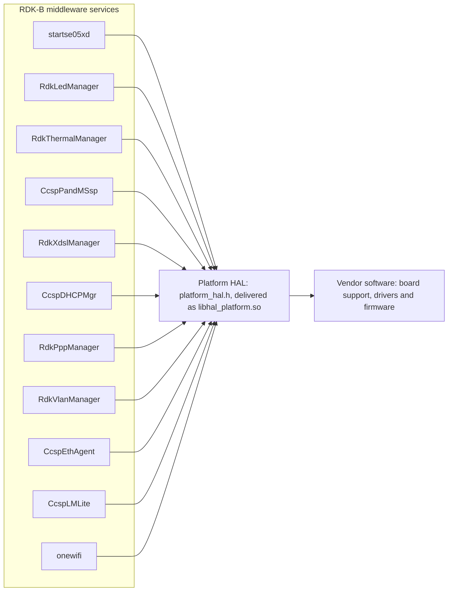
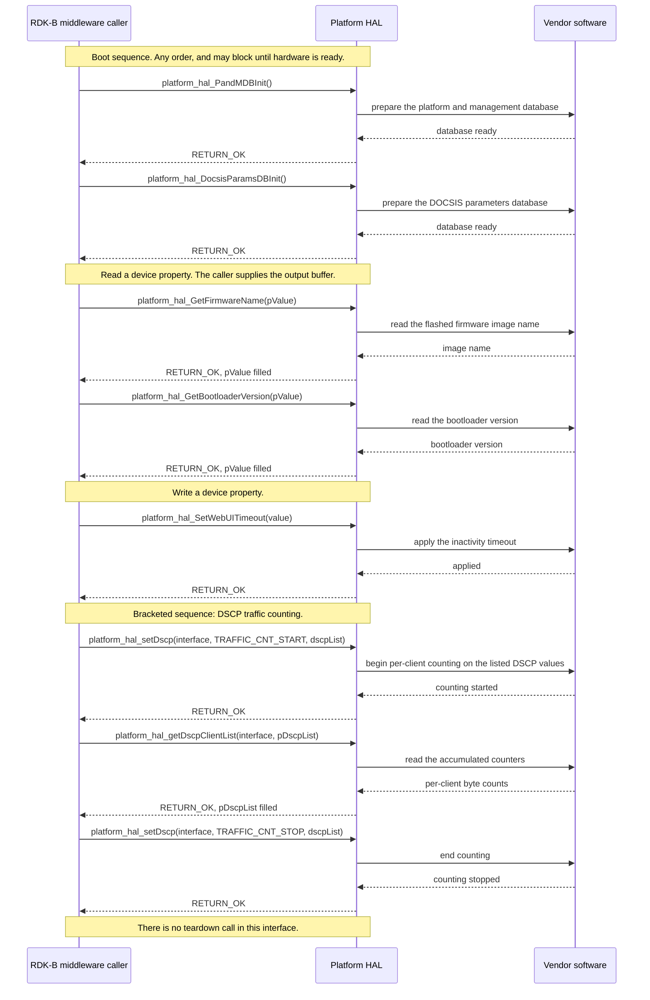

# PLATFORM HAL Documentation

## Version History

| Date | Comment | Version |
| --- | --- | --- |
| 2026-08-24 | Specification rewritten to the canonical RDK-B HAL topic set. Documentation only: the interface itself is unchanged, so this revision introduces no new release. | 1.3.3 (documentation revision) |
| Not stated in `CHANGELOG.md` | Return value extended for unsupported HAL functions through `RETURN_UNSUPPORTED`, and the thermal manager functions implemented for XB10 and XB9, under RDKB-65287. | 1.3.3 |
| 2024-11-29 | `platform_hal.h` corrected under issue #23. | 1.3.2 |
| 2024-11-29 | Major version check aligned to `main` under issue #11; `build_ut.sh` updated. | 1.3.1 |
| 2024-11-27 | QoS and traffic management added through `platform_hal_qos_apply`. | 1.3.0 |
| 2024-11-25 | PPP username and password reads added under RDKBDEV-2733. | 1.2.1 |
| 2023-12-28 | ECO mode status read added under RDKBDEV-2326. | 1.2.0 |
| 2023-11-20 | DHCP option defines extended; header updated for the unified WAN manager under RDKB-52640. | 1.1.0 |
| 2023-11-13 | Repository housekeeping only; the declared interface did not change. | 1.0.1 |
| 2023-11-08 | Initial Platform HAL interface release under RDKB-52300. | 1.0.0 |

Four distinct version identities apply to this repository and must not be conflated:

- **Document revision** \- the state of this specification, recorded in the first row above.
- **Interface version** \- **this interface declares none.** Unlike some sibling HALs,
  `platform_hal.h` defines no major, minor or maintenance version macro, so a caller cannot test
  the Platform HAL interface version at compile time or at run time. Callers that need to
  distinguish interface revisions must do so from the release the header was delivered in.
- **Release tag** \- the SemVer releases listed above, of which `1.3.3` is the most recent. The
  `CHANGELOG.md` entry for `1.3.3` carries no date line, so no release date is stated for it here
  rather than one being inferred.
- **Generated documentation version string** \- `docs/generate_docs.sh` passes the output of
  `git describe --tags` as `PROJECT_VERSION`. The nearest ancestor tag is currently the
  integration tag `BPI-STABLE-2025Q1`, which post-dates release `1.3.3`, so that string takes the
  form `BPI-STABLE-2025Q1-<n>-g<abbreviated-commit>`, where `<n>` is the number of commits since
  the tag. It is a build identifier and carries no SemVer release number; it must not be read as
  an interface version.

*Source: `CHANGELOG.md`, the repository tag list, `docs/generate_docs.sh` and
`include/platform_hal.h`.*

## Acronyms

- `HAL` \- Hardware Abstraction Layer
- `RDK-B` \- Reference Design Kit for Broadband Devices
- `OEM` \- Original Equipment Manufacturer
- `SoC` \- System on a Chip
- `DOCSIS` \- Data Over Cable Service Interface Specification
- `DRAM` \- Dynamic Random Access Memory
- `DSCP` \- Differentiated Services Code Point
- `eMMC` \- embedded MultiMediaCard
- `ECO` \- Energy Conservation Operation, the device power-saving mode
- `LED` \- Light Emitting Diode
- `MACsec` \- Media Access Control Security
- `PandM` \- Platform and Management, the RDK-B provisioning and management database
- `PPP` \- Point-to-Point Protocol
- `PSM` \- Power Saving Mode
- `PWM` \- Pulse Width Modulation
- `QoS` \- Quality of Service
- `RPM` \- Revolutions Per Minute
- `SNMP` \- Simple Network Management Protocol
- `WAN` \- Wide Area Network

*Source: the terms used in this document, expanded against `include/platform_hal.h`.*

## Description

Platform HAL is the RDK-B abstraction over board and device details that belong to no single
subsystem. It is the interface through which RDK-B middleware reads hardware and firmware
identity such as the model name, serial number, base MAC address, hardware revision, software
version, bootloader version and firmware image name; reads flash and DRAM sizing; toggles remote
management surfaces such as Telnet, SSH, SNMP and the web user interface; drives LED, fan and
thermal control; and applies QoS, DSCP traffic counting and MACsec settings. The vendor supplies
the implementation behind it; the interface itself declares no implementation.

Platform HAL has the widest set of dependents of any HAL in this collection. Eleven RDK-B
middleware services reach the hardware through this one interface, so the interface is a fan-in
rather than the single service-to-HAL chain most RDK-B HALs form.



The diagram below is retained from the earlier revision of this specification and was checked
against the interface before being kept. It carries one thing the flowchart above does not: it
shows that the callers divide into two classes, RDK-B `Ccsp` components and plain processes that
are not `Ccsp` components, inside an explicit RDK-B stack boundary. That distinction corroborates
the process model stated below. The flowchart carries what the raster does not, namely the
identity of the eleven services.


This raster is re-audited against the interface whenever this topic changes.

*Source: `include/platform_hal.h` for the interface content; the RDK-B repository inventory
`README.md` for the dependent service names and for the observation that this HAL has the widest
set of dependents.*

## Optional Components

Every function in this interface is declared unconditionally except the nine gated by the two
compile-time feature flags below. A caller compiled against a header where a flag is undefined
will not see the corresponding declarations at all, so the availability of these functions is a
build-time property rather than a run-time one.

- `FEATURE_RDKB_LED_MANAGER` gates exactly one function,
  [`platform_hal_initLed`](../../include/platform_hal.h#L1468). It additionally gates the
  `led_name` and `led_param` members of
  [`LEDMGMT_PARAMS`](../../include/platform_hal.h#L1408), so the structure a caller populates for
  `platform_hal_setLed` differs in shape between the two builds.
- `FEATURE_RDKB_THERMAL_MANAGER` gates eight functions:
  [`platform_hal_initThermal`](../../include/platform_hal.h#L1762),
  [`platform_hal_LoadThermalConfig`](../../include/platform_hal.h#L1796),
  [`platform_hal_setFanSpeed`](../../include/platform_hal.h#L1868),
  [`platform_hal_getFanTemperature`](../../include/platform_hal.h#L1904),
  [`platform_hal_getInputCurrent`](../../include/platform_hal.h#L1940),
  [`platform_hal_getInputPower`](../../include/platform_hal.h#L1975),
  [`platform_hal_getRadioTemperature`](../../include/platform_hal.h#L2017) and
  [`platform_hal_getEcoModeStatus`](../../include/platform_hal.h#L2057). It also gates the types
  [`FAN_SPEED`](../../include/platform_hal.h#L1691),
  [`THERMAL_PLATFORM_CONFIG`](../../include/platform_hal.h#L1706) and
  [`FAN_ERR`](../../include/platform_hal.h#L1811).

**The gating is deliberately asymmetric, and a caller must not generalise from the names.** The
LED functions `platform_hal_setLed` and `platform_hal_getLed` are unconditional; only
`platform_hal_initLed` is gated. The fan readings `platform_hal_getFanSpeed`,
`platform_hal_getRPM`, `platform_hal_getRotorLock` and `platform_hal_getFanStatus`, and the
override `platform_hal_setFanMaxOverride`, are all unconditional even though they concern the same
hardware as the gated thermal block; `platform_hal_setFanMaxOverride` is declared two lines above
the `FEATURE_RDKB_THERMAL_MANAGER` guard.

Two consequences follow for a caller.

- `platform_hal_initThermal` is one of the three boot-time initialization calls named under
  **Initialization and Startup**, and it is gated. A caller built without
  `FEATURE_RDKB_THERMAL_MANAGER` performs a two-call initialization sequence rather than a
  three-call one.
- `RETURN_UNSUPPORTED` was added to this interface in release `1.3.3` under RDKB-65287 alongside
  the thermal manager work, and it is documented on exactly six functions, all of them within the
  gated thermal block: `platform_hal_setFanSpeed`, `platform_hal_getFanTemperature`,
  `platform_hal_getInputCurrent`, `platform_hal_getInputPower`,
  `platform_hal_getRadioTemperature` and `platform_hal_getEcoModeStatus`. No other function in
  this interface returns it. See **Internal Error Handling**.

*Source: the preprocessor structure and the `@note` content of `include/platform_hal.h`;
`CHANGELOG.md` for the release that introduced `RETURN_UNSUPPORTED`.*

## Component Runtime Execution Requirements

### Initialization and Startup

The initialization functions below give the vendor implementation the opportunity to open the
databases it needs, start any internal threads and prepare the hardware. The client is expected to
call them during the boot sequence, and **this interface places no ordering constraint between
them: they may be called in any order.**

- [`platform_hal_PandMDBInit`](../../include/platform_hal.h#L653)
- [`platform_hal_DocsisParamsDBInit`](../../include/platform_hal.h#L681)
- [`platform_hal_initThermal`](../../include/platform_hal.h#L1762) \- declared only when
  `FEATURE_RDKB_THERMAL_MANAGER` is defined, so a build without that flag has a two-call
  initialization sequence

Third-party vendors implement these appropriately to meet operational requirements. **This
interface is expected to block if the hardware is not ready.** A caller must therefore treat
initialization as a call that may take an indeterminate time rather than one that returns
promptly.

[`platform_hal_initLed`](../../include/platform_hal.h#L1468) is an initialization call for the LED
subsystem specifically rather than part of the boot sequence above. It is declared only when
`FEATURE_RDKB_LED_MANAGER` is defined, it reports the path of the vendor's LED configuration file,
and its own documentation directs a caller that receives `RETURN_ERR` from it to treat the LED
subsystem as unavailable and not to call the other LED functions. That is the one initialization
dependency this interface states.

There is no teardown, close or deinitialization function anywhere in this interface. See
**Object Lifecycles**.

*Source: the prior revision of this specification for the boot-time policy, cross-checked against
the declarations and `@pre`/`@retval` content of `include/platform_hal.h`.*

### Threading Model

**The interface is not thread safe.**

Any module which is invoking the API should ensure calls are made in a thread safe manner. Every
function in this interface repeats that obligation on its own declaration: a caller must serialise
each call against every other Platform HAL call it makes.

This statement is specific to Platform HAL and is deliberately not aligned with sibling HALs that
declare themselves thread safe. It is the policy this repository states, and it is what the
per-function documentation in `include/platform_hal.h` is written against.

Different third-party vendors are allowed to create internal threads to meet their operational
requirements. In that case the third-party implementation is responsible for synchronizing between
the calls and events and for cleaning up the thread.

*Source: the prior revision of this specification, corroborated by the per-function
`@note Not thread safe` content in `include/platform_hal.h`.*

### Process Model

All functions in this interface are expected to be called from multiple processes. The two classes
of caller are visible in the architecture diagram under **Description**: RDK-B `Ccsp` components
and processes that are not `Ccsp` components. Because the interface is not thread safe and offers
no cross-process locking of its own, a vendor implementation must protect any shared platform
resource it touches against concurrent entry from more than one process.

*Source: the prior revision of this specification and the architecture diagram it carries.*

### Memory Model

All strings this interface exchanges are zero-terminated. Every output buffer documented in
`include/platform_hal.h` is described as receiving a zero-terminated value, and the buffer minimum
sizes are stated per function on the declaration.

#### Caller Responsibilities

- The client is responsible for allocating and de-allocating memory for the functions that
  require it, as specified in the API documentation on each declaration.
- Where a function documents a minimum buffer size, the caller must honour it. This interface
  defines no length argument and no truncation behaviour for its string outputs, so a caller that
  supplies a shorter buffer has no defined protection against an overrun.
- Where a structure is passed in, the caller allocates it, populates it fully and owns it. The
  implementation reads it during the call only and does not retain the pointer after the call
  returns.
- One function inverts this and the caller must not miss it:
  [`platform_hal_GetMemoryPaths`](../../include/platform_hal.h#L2305) allocates a
  [`PLAT_PROC_MEM_INFO`](../../include/platform_hal.h#L266) array itself and returns it through a
  caller-held pointer, rather than filling a caller-supplied buffer.

#### Module Responsibilities

- Third-party vendors are allowed to allocate memory for their internal operational requirements.
  In that case the third-party implementation is responsible for de-allocating it internally.
- A module must release all internally allocated memory when it terminates or closes its
  connection to the HAL, so that no resource is leaked across a service restart.
- A module must not retain a caller-supplied pointer beyond the call that carried it.

*Source: the prior revision of this specification for the allocation policy; the `@param`,
`@warning` and `@note` content of `include/platform_hal.h` for buffer ownership, minimum sizes and
the one allocating function.*

### Power Management Requirements

The HAL is not involved in any of the power management operation. Any power management state
transitions MUST not affect the operation of the HAL.

Two functions in this interface concern power state as *data* and do not make the HAL a
participant in power management. [`platform_hal_SetLowPowerModeState`](../../include/platform_hal.h#L2478)
carries a [`PSM_STATE`](../../include/platform_hal.h#L2430) value, and
[`platform_hal_getEcoModeStatus`](../../include/platform_hal.h#L2057) reports the ECO mode status
of a radio module. Both report or set data-model state only.

*Source: the prior revision of this specification, and the `@note` on `PSM_STATE` in
`include/platform_hal.h` stating that these values are data-model state only.*

### Asynchronous Notification Model

There are no asynchronous notifications.

This interface declares no function-pointer typedef and no callback registration function, so
there is no mechanism by which a vendor implementation could notify a caller of an event. Every
value a caller needs is obtained by calling a function and reading its output. A caller that needs
to observe a changing quantity, such as a temperature or an interface counter, must poll it.

*Source: `include/platform_hal.h`, in which the count of function-pointer typedefs and of
registration functions is zero.*

### Blocking calls

**Synchronous:** every function in this interface operates synchronously. The calling thread is
blocked until the operation completes, and each declaration in `include/platform_hal.h` states
this on its own `@execution` line.

**No published time bound:** **this interface publishes no numeric timeout or completion time for
any of its functions.** That is stated per function in the header rather than left implicit. A
caller must therefore not assume a bound, and a caller that needs one must impose its own timeout
around the call and decide for itself how to treat a call that has not returned.

**Calls known to take longer:** [`platform_hal_StartMACsec`](../../include/platform_hal.h#L2235)
and [`platform_hal_StopMACsec`](../../include/platform_hal.h#L2264) take an explicit timeout
argument and wait for the outcome, and initialization is expected to block while the hardware is
not ready. These are the calls a caller should expect to hold a thread longest.

*Source: the prior revision of this specification for the synchronous-with-timeout policy,
sharpened against the `@execution` lines and the timeout arguments declared in
`include/platform_hal.h`.*

### Internal Error Handling

All Platform HAL functions that report status do so synchronously, as the return value. The HAL is
responsible for handling system errors, such as an out-of-memory condition, internally.

Three status codes are defined, and the set a caller must handle differs by function.

- [`RETURN_OK`](../../include/platform_hal.h#L161), value 0 \- the operation completed
  successfully.
- [`RETURN_ERR`](../../include/platform_hal.h#L171), value -1 \- the operation failed. This
  interface reports no more specific cause, so a caller should discard any output, and retry or
  report the failure.
- [`RETURN_UNSUPPORTED`](../../include/platform_hal.h#L183), value -2 \- the platform does not
  implement the function. It is returned by exactly six functions, all inside the
  `FEATURE_RDKB_THERMAL_MANAGER` block: `platform_hal_setFanSpeed`,
  `platform_hal_getFanTemperature`, `platform_hal_getInputCurrent`, `platform_hal_getInputPower`,
  `platform_hal_getRadioTemperature` and `platform_hal_getEcoModeStatus`. Unlike `RETURN_ERR` this
  outcome is permanent for the platform, so a caller should stop polling rather than retry.

Four functions do not participate in this scheme at all, and treating their return value as a
status code is an error:

- [`platform_hal_getRotorLock`](../../include/platform_hal.h#L1619) returns its own discrete codes
  \- 1 for a locked rotor, 0 for an unlocked rotor, and -1 where the platform or the selected fan
  provides no rotor lock indication. The -1 case means "unknown", not "not locked", and must not
  be read as a generic failure even though it shares the numeric value of `RETURN_ERR`.
- [`platform_hal_getFanSpeed`](../../include/platform_hal.h#L1560),
  [`platform_hal_getRPM`](../../include/platform_hal.h#L1587) and
  [`platform_hal_getFanStatus`](../../include/platform_hal.h#L1645) return a reading or a state
  rather than a status code, and **this interface defines no distinguished value by which any of
  them signals failure.** A caller consequently cannot separate a genuine reading of 0, or a
  disabled fan, from a failed query. That is a property of the interface, not an omission in this
  document, and a caller that needs to detect failure on these three must obtain corroboration
  elsewhere.

*Source: the prior revision of this specification for the synchronous-error policy; the status
code definitions and the per-function `@retval`, `@return` and `@note` content of
`include/platform_hal.h` for everything else.*

### Persistence Model

There is no requirement for the HAL to persist any setting information. The caller is responsible
for persisting any settings related to its own implementation.

Two qualifications follow from the interface itself. The values behind
[`platform_hal_getFactoryPartnerId`](../../include/platform_hal.h#L1308),
[`platform_hal_getFactoryCmVariant`](../../include/platform_hal.h#L1342) and
[`platform_hal_GetFactoryResetCount`](../../include/platform_hal.h#L1162) are factory- or
device-held rather than HAL-held, and a caller reads them rather than persisting them. And
[`platform_hal_GetInterfaceStats`](../../include/platform_hal.h#L2886) documents that this
interface does not specify the point from which its counters accumulate or whether anything resets
them, so a caller that needs a rate must difference two reads rather than assume a starting value
or a persisted baseline.

*Source: the prior revision of this specification, and the `@note` content on the interface
statistics structure in `include/platform_hal.h`.*

## Non functional requirements

The following non functional requirements should be supported by the component.

### Logging and debugging requirements

The component is required to log all error and critical informative messages that help to debug
and triage issues and to understand the functional flow of the system. Logging should use the
`syslog` mechanism, which suits system-level software; the use of `printf` is discouraged unless
`syslog` is unavailable. Logging should be consistent across all HAL components.

**This interface does not fix a vendor log file name or a log directory.** Neither
`include/platform_hal.h` nor this repository names one, so no name and no path is asserted here.
A vendor implementation that logs to a file must agree the name and location with the integrator
rather than inferring either from a sibling HAL, whose file names are specific to that HAL.

Log levels follow Linux standard logging. Entries should be categorised by the levels below,
listed in descending order of severity:

- **FATAL:** critical conditions, typically indicating a crash or a severe failure requiring
  immediate attention.
- **ERROR:** non-fatal error conditions that nonetheless significantly impede normal operation.
- **WARNING:** potentially harmful situations that are not yet errors.
- **NOTICE:** important events that are not errors.
- **INFO:** general informational messages describing normal operation.
- **DEBUG:** detailed information useful when diagnosing a problem.
- **TRACE:** fine-grained logging that traces internal flow.

Each entry should carry a timestamp, the log level and a message describing the event or
condition, so that log files can be parsed consistently across vendors and components.

Two properties of this interface make logging materially more important here than the general
requirement suggests. `RETURN_ERR` reports no cause, so the log is the only place a cause can be
recorded; and `platform_hal_getFanSpeed`, `platform_hal_getRPM` and
`platform_hal_getFanStatus` have no failure value at all, so a failed query on those three is
invisible to the caller and must be logged by the implementation if it is to be diagnosable.

*Source: the prior revision of this specification for the logging obligation and the Linux
standard log levels; the absence of any log file declaration in `include/platform_hal.h` and in
this repository for the statement that none is specified.*

### Memory and performance requirements

The component should not contribute disproportionately to memory or CPU utilization while
performing normal operations, and its consumption should be commensurate with the operation
requested.

**No memory footprint limit is specified for this interface.** No numeric limit on resident
memory, on allocation size or on CPU utilization is declared by `include/platform_hal.h` or
anywhere else in this repository, so none is stated here and a caller must not assume one.

Two bounded costs are declared and are the figures a caller can size against. The fixed-capacity
output structure [`DSCP_list_t`](../../include/platform_hal.h#L2583) holds up to 64
[`DSCP_Element_t`](../../include/platform_hal.h#L2568) entries, each holding up to 256
[`Traffic_client_t`](../../include/platform_hal.h#L2554) entries, and the caller allocates the
whole structure including both arrays; that single allocation dominates the memory cost of this
interface. And every string output has a per-function documented minimum buffer size.

*Source: the prior revision of this specification for the utilization requirement; the structure
capacities declared in `include/platform_hal.h`; the absence of any declared limit for the
statement that no footprint limit is specified.*

### Quality Control

The Platform HAL implementation should pass `Coverity`, `Black Duck` and `Valgrind` checks without
any issue. No memory leak or memory corruption should be introduced by the HAL or by the
underlying third-party software implementation.

This specification is derived from the artefacts each topic cites. **Any change to a cited
artefact obliges a review of the topics that cite it** \- in particular, a change to
`include/platform_hal.h` obliges a review of **Optional Components**, **Data Structures and
Defines**, **API Surface**, **Sequence Diagram**, **State Diagram** and **Internal Error
Handling**, and a change to `CHANGELOG.md` obliges a review of **Version History**. The raster in
**Description** is re-audited whenever that topic changes.

That obligation is addressed to the `rdkcentral/rdkb-halif-platform` maintainers, reached through
this repository's issue tracker and its pull-request review flow as described in
`CONTRIBUTING.md`. **This repository contains no `CODEOWNERS` file**, so no narrower owner is
named here.

*Source: the prior revision of this specification for the static-analysis requirement;
`CONTRIBUTING.md` for the review route; the contents of `.github/`, which holds only the
contributor licence agreement workflow, for the absence of a `CODEOWNERS` file.*

### Licensing

The Platform HAL implementation is expected to be released under the Apache License 2.0. The
licence text delivered with this repository is reachable from this documentation set as
`LICENSE.md` and `COPYING.md`, with the attribution notice as `NOTICE.md`.

*Source: the prior revision of this specification and the licence files delivered in this
repository.*

### Build Requirements

The source code should be built under the Linux Yocto environment and should be delivered as a
shared library named `libhal_platform.so`.

To use the Platform HAL capabilities from a component or process:

1. Include `platform_hal.h`, which carries all function prototypes and datatype definitions for
   this interface.
2. Add a linker dependency on `libhal_platform.so`.

One property of the generated documentation is worth stating, because a reader of the generated
site would otherwise draw the wrong conclusion about the size of this interface.
`docs/generate_docs.sh` passes `DOXYGEN_EXTRA_PARAMS` with both `FEATURE_RDKB_THERMAL_MANAGER` and
`FEATURE_RDKB_LED_MANAGER` predefined, with the intent that the flag-gated declarations be
extracted. **The generator does not act on that setting.** Its `Makefile` exports only
`PROJECT_NAME` and `PROJECT_VERSION` and never references `DOXYGEN_EXTRA_PARAMS`, and `PREDEFINED`
in its Doxygen configuration is empty, so the variable is accepted on the command line and
discarded. Building this repository's documentation consequently extracts 62 of the 71 declared
functions; the nine absent from the generated reference are exactly the nine flag-gated functions
listed under **Optional Components**.

**The header and the API Surface topic of this document are therefore the authority for the
complete surface, and the generated function index is not.** The generator is maintained outside
this repository and is consumed at a pinned revision, so this specification records the behaviour
rather than working around it.

*Source: the prior revision of this specification for the artefact and the toolchain;
`docs/generate_docs.sh` for the flags it passes; the generator's own `Makefile` and Doxygen
configuration at the pinned revision, and a build of this repository's documentation against them,
for the extraction result.*

### Variability Management

Any new function introduced into this interface should be implemented by all third-party modules,
and the RDK generic code should be compatible with a specific version of the HAL software.

Each interface is versioned using [Semantic Versioning 2.0.0](https://semver.org/), and the vendor
code complies with a specific version of the interface. Note the limitation recorded under
**Version History**: the version applies to the released interface, and this header declares no
version macro, so the version cannot be tested from code.

The two compile-time flags are the only declared variability in this interface, and their effect
is enumerated under **Optional Components**. `RETURN_UNSUPPORTED` provides the run-time
counterpart within the gated thermal block: a platform that compiles those declarations in but
does not implement the function reports that fact through the return value rather than through the
absence of a symbol.

*Source: the prior revision of this specification for the versioning policy;
`include/platform_hal.h` for the flags and for the absence of a version macro.*

### Platform or Product Customization

The product can be configured through the following compile-time defines:

```c
FEATURE_RDKB_LED_MANAGER        /* Enable the LED Manager */
FEATURE_RDKB_THERMAL_MANAGER    /* Enable the Thermal Manager */
```

The effect of each flag on the declared surface is enumerated under **Optional Components**,
including the asymmetry that leaves the fan readings and the two non-initializing LED functions
unconditional. Beyond these two flags, product variation is carried in the *values* this interface
reports rather than in its shape: the model name, router region, hardware version, factory partner
identifier and factory cable-modem variant are all read through it, and the LED colour set, the
fan count and the thermal thresholds are all documented as vendor or OEM specific.

The RDK-B repository inventory records an upstream intention to move the thermal and LED functions
into HALs of their own. That is an intention recorded upstream, not a property of the interface as
delivered here: both function families are declared in `platform_hal.h` in this release, and this
document describes them as part of this interface.

*Source: the prior revision of this specification for the flag list; `include/platform_hal.h` for
the vendor-specific and OEM-specific value ranges; the RDK-B repository inventory `README.md` for
the upstream intention.*

## Interface API Documentation

All function prototypes and datatype definitions for this interface are declared in
`include/platform_hal.h`, and the per-function reference \- argument ranges, buffer ownership and
minimum sizes, pre-conditions, post-conditions, every return value and its meaning, blocking
behaviour and thread safety \- is carried in the Doxygen comment on each declaration. The topics
below index that surface and state the concepts a caller needs in order to read it.

### Theory of operation and key concepts

Platform HAL is a flat, stateless-to-the-caller function interface. There is no handle, no session
and no object a caller creates or destroys. A caller includes the header, links the library,
performs the boot-time initialization calls, and thereafter calls individual functions that each
read or set one platform property. Almost every function is a getter or a setter over a single
quantity; the exceptions are the DSCP traffic-counting group, which accumulates counters between a
start and a stop, and the MACsec group, which starts and stops a protocol on a port.

The interface divides into two behavioural kinds, and the distinction matters more than the
functional grouping does:

- **Status-reporting functions** return `RETURN_OK`, `RETURN_ERR` or, for six thermal functions,
  `RETURN_UNSUPPORTED`, and deliver their result through an output argument. Sixty-seven of the
  seventy-one functions are of this kind.
- **Value-returning functions** return the reading itself and have no separate status channel.
  These are `platform_hal_getFanSpeed`, `platform_hal_getRPM`, `platform_hal_getFanStatus` and
  `platform_hal_getRotorLock`. Only the last of these defines a value meaning "not applicable";
  the other three define no failure value at all. See **Internal Error Handling**.

#### Object Lifecycles

- **Creation.** This interface creates nothing on the caller's behalf and exposes no object
  identity. The three boot-time initialization functions prepare vendor-internal state; they
  return no handle, and nothing a caller holds refers to that state.
- **Usage.** The caller allocates the structures the interface fills \-
  [`LEDMGMT_PARAMS`](../../include/platform_hal.h#L1408),
  [`THERMAL_PLATFORM_CONFIG`](../../include/platform_hal.h#L1706),
  [`FW_BANK_INFO`](../../include/platform_hal.h#L2763),
  [`INTF_STATS`](../../include/platform_hal.h#L2833),
  [`DSCP_list_t`](../../include/platform_hal.h#L2583),
  [`hal_network_params_t`](../../include/platform_hal.h#L2995) \- and owns them for their whole
  lifetime. The implementation reads or fills them during the call and does not retain the pointer.
- **Destruction.** The caller de-allocates what it allocated. **There is no teardown,
  deinitialization or close function in this interface**, so the vendor-internal state established
  at initialization persists for the lifetime of the process and is not releasable through this
  interface. A caller must not look for a counterpart to the initialization calls.
- **The one exception to caller allocation.**
  [`platform_hal_GetMemoryPaths`](../../include/platform_hal.h#L2305) allocates a
  [`PLAT_PROC_MEM_INFO`](../../include/platform_hal.h#L266) array and returns it through a
  caller-held pointer. Its declaration documents this asymmetry explicitly.
- **Identifiers.** The interface addresses hardware by small integer index rather than by object
  identity: a fan index, an Ethernet port number, a radio index, an LED index bounded by
  [`LED_BUFFER_SIZE`](../../include/platform_hal.h#L1383), a processor selected by
  [`RDK_CPUS`](../../include/platform_hal.h#L233), a firmware bank selected by
  [`FW_BANK`](../../include/platform_hal.h#L2751) and a WAN interface selected by
  [`WAN_INTERFACE`](../../include/platform_hal.h#L2530).

#### Method Sequencing

- **Initialization first.** The boot-time initialization calls listed under **Initialization and
  Startup** are made during the boot sequence, and **they may be made in any order**. This
  interface establishes no order among them.
- **Which functions depend on which initialization call is not established by this interface.**
  The initialization calls exist so that dependent functions can work, but neither the header nor
  this repository states which function depends on which initialization call. A caller must
  therefore perform the full initialization sequence for its build rather than infer a narrower
  dependency, and this document does not supply a dependency map, because none is established.
  The one dependency that *is* stated is the LED one: a `RETURN_ERR` from
  `platform_hal_initLed` means the other LED functions must not be called.
- **Paired sequences.** Three groups have an order of their own.
  `platform_hal_setDscp` with `TRAFFIC_CNT_START` begins traffic counting, and
  `platform_hal_getDscpClientList` reads the accumulated counters, which
  `platform_hal_resetDscpCounts` clears and `platform_hal_setDscp` with `TRAFFIC_CNT_STOP` ends.
  `platform_hal_StartMACsec` and `platform_hal_StopMACsec` bracket MACsec operation on a port,
  with `platform_hal_GetMACsecOperationalStatus` reporting the achieved state as against the
  administrative setting read by `platform_hal_GetMACsecEnable`.
  `platform_hal_LoadThermalConfig` supplies the default thresholds a caller may then apply.
- **Everything else is order-independent** once initialization has completed, subject only to the
  serialisation the **Threading Model** requires.

#### State-Dependent Behavior

- **Configuration progress.** [`platform_hal_GetDeviceConfigStatus`](../../include/platform_hal.h#L331)
  reports how far the device has progressed through its configuration sequence, returning one of
  the tokens `WaitForImplement`, `In Progress` or `Complete`. A caller uses it to decide whether
  configuration-dependent work may proceed.
- **Administrative against operational state.** `platform_hal_GetMACsecEnable` reports the
  administrative setting and `platform_hal_GetMACsecOperationalStatus` reports whether MACsec is
  actually configured at the interface or driver level. The two can legitimately disagree, and a
  caller that needs the truth about the link must read the operational one.
- **Readings change with hardware state.** The fan, temperature, current, power and interface
  statistics functions return values that depend on the platform's condition at the time of the
  call. `platform_hal_GetInterfaceStats` in particular does not specify the point from which its
  counters accumulate, so successive reads must be differenced.
- **Build state changes the surface.** Nine functions are absent from the declared surface when
  their feature flag is undefined, and six thermal functions may report `RETURN_UNSUPPORTED` at
  run time even when declared. Both are enumerated under **Optional Components**.
- **Transitions are not specified.** The values above are states a caller can observe; this
  interface does not define which transitions between them are legal or in what order they occur.
  See **State Diagram**.

*Source: `include/platform_hal.h` throughout, including its `@param`, `@pre`, `@post`, `@note` and
`@see` content; the prior revision of this specification for the "any order" initialization
statement.*

### Data Structures and Defines

The types below are the ones a caller must construct or interpret, because they appear in the
signatures of this interface. Each links to its declaration.

**Status codes.** Returned by the sixty-seven status-reporting functions; see **Internal Error
Handling** for which function returns which.

| Define | Value | Meaning |
| --- | --- | --- |
| [`RETURN_OK`](../../include/platform_hal.h#L161) | 0 | The operation completed successfully. |
| [`RETURN_ERR`](../../include/platform_hal.h#L171) | -1 | The operation failed; no cause is reported. |
| [`RETURN_UNSUPPORTED`](../../include/platform_hal.h#L183) | -2 | The platform does not implement the function. Permanent; six thermal functions only. |

**Primitive type aliases.** This interface expresses its signatures in aliases rather than in the
underlying C types, so a caller reading a declaration needs them:
[`CHAR`](../../include/platform_hal.h#L109) for `char`,
[`UCHAR`](../../include/platform_hal.h#L113) for `unsigned char`,
[`BOOLEAN`](../../include/platform_hal.h#L117) for `unsigned char` carrying
[`TRUE`](../../include/platform_hal.h#L149) or [`FALSE`](../../include/platform_hal.h#L153),
[`INT`](../../include/platform_hal.h#L121) for `int`,
[`UINT`](../../include/platform_hal.h#L125) for `unsigned int`,
[`ULONG`](../../include/platform_hal.h#L129) for `unsigned long`, and the fixed-width aliases
[`UINT8_t`](../../include/platform_hal.h#L133),
[`UINT16_t`](../../include/platform_hal.h#L137),
[`UINT32_t`](../../include/platform_hal.h#L141) and
[`UINT64_t`](../../include/platform_hal.h#L145).
[`ENABLE`](../../include/platform_hal.h#L157) is also defined, and its own comment records that no
declaration in the header refers to it.

**Buffer and capacity limits.** [`FW_NAME_MAX_LEN`](../../include/platform_hal.h#L218) 64 and
[`FW_STATE_MAX_LEN`](../../include/platform_hal.h#L219) 64 size the firmware bank strings;
[`PLAT_PROC_MEM_MAX_LEN`](../../include/platform_hal.h#L250) 40 sizes each memory path string;
[`LED_BUFFER_SIZE`](../../include/platform_hal.h#L1383) 3 is the number of LED entries a caller
may address. Functions that write a string into a caller buffer state their own minimum size on
the declaration rather than through a macro.

**DHCP option codes.** [`DHCPV6_OPT_3`](../../include/platform_hal.h#L187) onwards and the
DHCPv4 set ending at [`DHCPV4_OPT_END`](../../include/platform_hal.h#L216), value 255, are the
codes carried in the `dhcp_opt` member of `dhcp_opt_list`. `DHCPV4_OPT_END` is the sentinel used
to check whether an option is valid.

**Enumerations and structures.**

| Type | Declaration | What it represents |
| --- | --- | --- |
| `RDK_CPUS` | [`:233`](../../include/platform_hal.h#L233) | Processor selector: `HOST_CPU`, `PEER_CPU`, `NOT_SUPPORTED_CPU`. Argument to `platform_hal_GetMemoryPaths`. |
| `PLAT_PROC_MEM_INFO` | [`:266`](../../include/platform_hal.h#L266) | DRAM and three eMMC storage paths for one processor, each bounded by `PLAT_PROC_MEM_MAX_LEN`. Allocated by the HAL, not by the caller. |
| `LED_COLOR` | [`:1389`](../../include/platform_hal.h#L1389) | LED colour selector, from `LED_WHITE` through the combined colours to `NOT_SUPPORTED`. |
| `LEDMGMT_PARAMS` | [`:1408`](../../include/platform_hal.h#L1408) | LED configuration: colour, state \- solid or blink \- and blink interval in seconds. Its `led_name` and `led_param` members exist only when `FEATURE_RDKB_LED_MANAGER` is defined. |
| `FAN_SPEED` | [`:1691`](../../include/platform_hal.h#L1691) | Discrete fan speed setting: `FAN_SPEED_OFF`, `SLOW`, `MEDIUM`, `FAST`, `MAX`. Thermal flag only. |
| `THERMAL_PLATFORM_CONFIG` | [`:1706`](../../include/platform_hal.h#L1706) | Platform fan configuration: fan count, the three temperature thresholds, minimum run time, monitoring delay, power monitoring and log interval. Thermal flag only. |
| `FAN_ERR` | [`:1811`](../../include/platform_hal.h#L1811) | Fan operation error state: `FAN_ERR_NONE`, `FAN_ERR_HW`, `FAN_ERR_MAX_OVERRIDE_SET`. Thermal flag only. |
| `dhcp_opt_list` | [`:2323`](../../include/platform_hal.h#L2323) | Singly linked list node carrying one DHCPv4 or DHCPv6 option code and its value. |
| `PSM_STATE` | [`:2430`](../../include/platform_hal.h#L2430) | Power saving mode state: `PSM_UNKNOWN`, `PSM_AC`, `PSM_BATT`, `PSM_HOT`, `PSM_COOLED`, `PSM_NOT_SUPPORTED`. Data-model state only. |
| `WAN_INTERFACE` | [`:2530`](../../include/platform_hal.h#L2530) | WAN interface selector for DSCP traffic counting: `DOCSIS`, `EWAN`. |
| `TRAFFIC_CNT_COMMAND` | [`:2542`](../../include/platform_hal.h#L2542) | Start or stop selector for DSCP traffic counting: `TRAFFIC_CNT_START`, `TRAFFIC_CNT_STOP`. |
| `Traffic_client_t` | [`:2554`](../../include/platform_hal.h#L2554) | Byte counters for one client against a single DSCP value, with the client MAC address. |
| `DSCP_Element_t` | [`:2568`](../../include/platform_hal.h#L2568) | One DSCP value with its client count and a fixed array of up to 256 client entries; only the first `numClients` are meaningful. |
| `DSCP_list_t` | [`:2583`](../../include/platform_hal.h#L2583) | Complete DSCP counting result for one WAN interface: up to 64 elements, of which only the first `numElements` are meaningful. |
| `FW_BANK` | [`:2751`](../../include/platform_hal.h#L2751) | Firmware bank selector: `ACTIVE_BANK`, `INACTIVE_BANK`. |
| `FW_BANK_INFO` | [`:2763`](../../include/platform_hal.h#L2763) | Firmware image name and trial-boot state for one bank, as zero-terminated strings. |
| `INTF_STATS` | [`:2833`](../../include/platform_hal.h#L2833) | Packet and byte counters for one network interface, covering LAN-to-WAN and WAN-to-LAN traffic only. |
| `ip_version_t` | [`:2972`](../../include/platform_hal.h#L2972) | IP version selector for QoS parameters: `IP_VERSION_IPV4`, `IP_VERSION_IPV6`. |
| `net_proto_t` | [`:2983`](../../include/platform_hal.h#L2983) | Transport protocol selector for QoS parameters: `PROTOCOL_TCP`, `PROTOCOL_UDP`. |
| `hal_network_params_t` | [`:2995`](../../include/platform_hal.h#L2995) | The QoS and traffic management parameter set: source and destination MAC and IP addresses, ports, protocol and DSCP value. |

Each of these types also carries a pointer alias where the interface uses one, for example
`PLEDMGMT_PARAMS`, `PPLAT_PROC_MEM_INFO`, `PPSM_STATE`, `PFW_BANK_INFO`, `PINTF_STATS`,
`pDSCP_list_t`, `pDSCP_Element_t` and `pTraffic_client_t`. The member-level meaning and the valid
range of every field are documented on the member itself in `include/platform_hal.h`.

**This interface declares no callback typedef and no callback registration function**, so there is
no notification type to document here. See **Asynchronous Notification Model**.

*Source: `include/platform_hal.h`, its type declarations and its member-level comments; the prior
revision of this specification for the header-and-linker guidance now carried under **Build
Requirements**.*

### API Surface

The complete declared surface of this interface is the seventy-one functions below, every one of
them named here by its exact identifier and linked to its declaration. Sixty-seven return `INT`,
two return `UINT`, one returns `BOOLEAN` and one returns lowercase `int`; **no function in this
interface returns `void`.** The nine functions marked *flag* are declared only when their feature
flag is defined, as set out under **Optional Components**.

This topic is the complete index. The generated Doxygen reference for this repository carries only
62 of the 71, for the reason recorded under **Build Requirements**, so the nine marked *flag* can
be found only here and in the header itself.

**Boot-time initialization:**

| Function | Purpose |
| --- | --- |
| [`platform_hal_PandMDBInit`](../../include/platform_hal.h#L653) | Initialises the Platform and Management database. |
| [`platform_hal_DocsisParamsDBInit`](../../include/platform_hal.h#L681) | Initialises the DOCSIS parameters database. |

**Device configuration status and remote management:**

| Function | Purpose |
| --- | --- |
| [`platform_hal_GetDeviceConfigStatus`](../../include/platform_hal.h#L331) | Reports how far the device has progressed through its configuration sequence. |
| [`platform_hal_GetTelnetEnable`](../../include/platform_hal.h#L357) | Reports whether Telnet access is currently enabled. |
| [`platform_hal_SetTelnetEnable`](../../include/platform_hal.h#L382) | Enables or disables Telnet access. |
| [`platform_hal_GetSSHEnable`](../../include/platform_hal.h#L408) | Reports whether SSH access is currently enabled. |
| [`platform_hal_SetSSHEnable`](../../include/platform_hal.h#L433) | Enables or disables SSH access. |
| [`platform_hal_GetSNMPEnable`](../../include/platform_hal.h#L462) | Reports which interface scope SNMP is currently enabled for. |
| [`platform_hal_SetSNMPEnable`](../../include/platform_hal.h#L491) | Selects the interface scope SNMP is enabled for. |
| [`platform_hal_SetSNMPOnboardRebootEnable`](../../include/platform_hal.h#L2089) | Allows or suppresses SNMP-initiated reboots during onboarding. |
| [`platform_hal_GetWebUITimeout`](../../include/platform_hal.h#L517) | Reports the configured web user-interface inactivity timeout. |
| [`platform_hal_SetWebUITimeout`](../../include/platform_hal.h#L542) | Sets the web user-interface inactivity timeout. |
| [`platform_hal_GetWebAccessLevel`](../../include/platform_hal.h#L577) | Reads the web access level granted to a user on an interface. |
| [`platform_hal_SetWebAccessLevel`](../../include/platform_hal.h#L625) | Sets the web access level granted to a user on an interface. |

**Device and firmware identity:**

| Function | Purpose |
| --- | --- |
| [`platform_hal_GetModelName`](../../include/platform_hal.h#L714) | Reads the device model name. |
| [`platform_hal_GetRouterRegion`](../../include/platform_hal.h#L747) | Reads the regulatory region the router is provisioned for. |
| [`platform_hal_GetSerialNumber`](../../include/platform_hal.h#L780) | Reads the device serial number. |
| [`platform_hal_GetHardwareVersion`](../../include/platform_hal.h#L814) | Reads the hardware revision of the device. |
| [`platform_hal_GetSoftwareVersion`](../../include/platform_hal.h#L846) | Reads the software version currently flashed on the device. |
| [`platform_hal_GetBootloaderVersion`](../../include/platform_hal.h#L878) | Reads the bootloader version currently flashed on the device. |
| [`platform_hal_GetFirmwareName`](../../include/platform_hal.h#L911) | Reads the name of the firmware image flashed on the device. |
| [`platform_hal_GetBaseMacAddress`](../../include/platform_hal.h#L946) | Reads the base MAC address of the device. |
| [`platform_hal_GetFirmwareBankInfo`](../../include/platform_hal.h#L2811) | Reads the firmware image name and state held in a given bank. |

**Flash and memory inventory:**

| Function | Purpose |
| --- | --- |
| [`platform_hal_GetHardware`](../../include/platform_hal.h#L980) | Reads the total flash size of the device in megabytes. |
| [`platform_hal_GetHardware_MemUsed`](../../include/platform_hal.h#L1013) | Reads the used flash size of the device in megabytes. |
| [`platform_hal_GetHardware_MemFree`](../../include/platform_hal.h#L1046) | Reads the available flash size of the device in megabytes. |
| [`platform_hal_GetTotalMemorySize`](../../include/platform_hal.h#L1075) | Reads the total DRAM size of the device in megabytes. |
| [`platform_hal_GetUsedMemorySize`](../../include/platform_hal.h#L1104) | Reads the DRAM currently in use, in megabytes. |
| [`platform_hal_GetFreeMemorySize`](../../include/platform_hal.h#L1133) | Reads the DRAM currently free, in megabytes. |
| [`platform_hal_GetMemoryPaths`](../../include/platform_hal.h#L2305) | Reads the DRAM and eMMC storage paths of a given processor. Allocates its own output. |
| [`platform_hal_GetCPUSpeed`](../../include/platform_hal.h#L2733) | Reads the processor speed in bogomips. |

**Factory state, reset and image validity:**

| Function | Purpose |
| --- | --- |
| [`platform_hal_GetFactoryResetCount`](../../include/platform_hal.h#L1162) | Reads how many times the device has been factory reset. |
| [`platform_hal_ClearResetCount`](../../include/platform_hal.h#L1187) | Clears the factory reset counter. |
| [`platform_hal_getTimeOffSet`](../../include/platform_hal.h#L1222) | Reads the device's time offset from UTC. |
| [`platform_hal_SetDeviceCodeImageTimeout`](../../include/platform_hal.h#L1247) | Sets the hardware watchdog timeout. |
| [`platform_hal_SetDeviceCodeImageValid`](../../include/platform_hal.h#L1274) | Marks the flashed firmware image valid or invalid. |
| [`platform_hal_getFactoryPartnerId`](../../include/platform_hal.h#L1308) | Reads the factory-programmed partner identifier. |
| [`platform_hal_getFactoryCmVariant`](../../include/platform_hal.h#L1342) | Reads the factory-programmed cable-modem variant. |
| [`platform_hal_setFactoryCmVariant`](../../include/platform_hal.h#L1372) | Sets the factory-programmed cable-modem variant. |

**LED control:**

| Function | Purpose |
| --- | --- |
| [`platform_hal_initLed`](../../include/platform_hal.h#L1468) | *flag* Initialises the LED layer and reports the path of its configuration file. |
| [`platform_hal_setLed`](../../include/platform_hal.h#L1499) | Applies an LED configuration to the device. |
| [`platform_hal_getLed`](../../include/platform_hal.h#L1530) | Reads the LED configuration in force at the time of the call. |

**Fan control and readings:**

| Function | Purpose |
| --- | --- |
| [`platform_hal_getFanSpeed`](../../include/platform_hal.h#L1560) | Reads the PWM-derived speed of a fan. Returns the reading, with no failure value. |
| [`platform_hal_getRPM`](../../include/platform_hal.h#L1587) | Reads the rotation rate of a fan. Returns the reading, with no failure value. |
| [`platform_hal_getRotorLock`](../../include/platform_hal.h#L1619) | Reads the rotor lock status of a fan: 1 locked, 0 unlocked, -1 not applicable. |
| [`platform_hal_getFanStatus`](../../include/platform_hal.h#L1645) | Reads whether a fan is enabled. Returns the state, with no failure value. |
| [`platform_hal_setFanMaxOverride`](../../include/platform_hal.h#L1674) | Forces a fan to maximum speed, or releases it back to normal control. |
| [`platform_hal_setFanSpeed`](../../include/platform_hal.h#L1868) | *flag* Sets a fan to one of the platform's discrete speed settings. |

**Thermal, power and ECO mode:**

| Function | Purpose |
| --- | --- |
| [`platform_hal_initThermal`](../../include/platform_hal.h#L1762) | *flag* Initialises the thermal layer and reports the platform's fan configuration. |
| [`platform_hal_LoadThermalConfig`](../../include/platform_hal.h#L1796) | *flag* Loads the default thermal thresholds into a configuration structure. |
| [`platform_hal_getFanTemperature`](../../include/platform_hal.h#L1904) | *flag* Reads the current device temperature. |
| [`platform_hal_getInputCurrent`](../../include/platform_hal.h#L1940) | *flag* Reads the platform's input current. |
| [`platform_hal_getInputPower`](../../include/platform_hal.h#L1975) | *flag* Reads the platform's input power. |
| [`platform_hal_getRadioTemperature`](../../include/platform_hal.h#L2017) | *flag* Reads the temperature of one radio module. |
| [`platform_hal_getEcoModeStatus`](../../include/platform_hal.h#L2057) | *flag* Reads the ECO mode status of one radio module. |
| [`platform_hal_SetLowPowerModeState`](../../include/platform_hal.h#L2478) | Sets the platform's power-saving mode state. |

**MACsec:**

| Function | Purpose |
| --- | --- |
| [`platform_hal_GetMACsecEnable`](../../include/platform_hal.h#L2130) | Reads whether MACsec is enabled on a port, administratively. |
| [`platform_hal_SetMACsecEnable`](../../include/platform_hal.h#L2162) | Enables or disables MACsec on a port. |
| [`platform_hal_GetMACsecOperationalStatus`](../../include/platform_hal.h#L2201) | Reads whether MACsec is actually configured at the interface or driver level. |
| [`platform_hal_StartMACsec`](../../include/platform_hal.h#L2235) | Starts MACsec on a port and waits for the outcome. |
| [`platform_hal_StopMACsec`](../../include/platform_hal.h#L2264) | Stops MACsec on a port and waits for the outcome. |

**WAN, DHCP options and PPP credentials:**

| Function | Purpose |
| --- | --- |
| [`platform_hal_GetDhcpv4_Options`](../../include/platform_hal.h#L2372) | Reads the DHCPv4 options the platform requests and sends. |
| [`platform_hal_GetDhcpv6_Options`](../../include/platform_hal.h#L2408) | Reads the DHCPv6 options the platform requests and sends. |
| [`platform_hal_getCMTSMac`](../../include/platform_hal.h#L2510) | Reads the MAC address of the CMTS the device is attached to. |
| [`platform_hal_GetInterfaceStats`](../../include/platform_hal.h#L2886) | Reads packet and byte counters for a named network interface. |
| [`platform_hal_GetPppUserName`](../../include/platform_hal.h#L2919) | Reads the PPP username configured for the WAN connection. |
| [`platform_hal_GetPppPassword`](../../include/platform_hal.h#L2954) | Reads the PPP password configured for the WAN connection. |

**DSCP traffic counting and QoS:**

| Function | Purpose |
| --- | --- |
| [`platform_hal_setDscp`](../../include/platform_hal.h#L2633) | Starts or stops per-client traffic counting for a set of DSCP values. |
| [`platform_hal_resetDscpCounts`](../../include/platform_hal.h#L2663) | Resets the DSCP traffic counters for a WAN interface. |
| [`platform_hal_getDscpClientList`](../../include/platform_hal.h#L2699) | Reads the accumulated DSCP traffic counters for a WAN interface. |
| [`platform_hal_qos_apply`](../../include/platform_hal.h#L3118) | Applies QoS and traffic management settings from a network parameter set. |

*Source: the declarations and `@brief` content of `include/platform_hal.h`; the line references are
the declaration lines in that file at the revision this document was written against.*

### Sequence Diagram

The exchange below uses declared identifiers only. It shows the boot-time initialization, a read,
a write and one of the two bracketed sequences, against the three participants this interface
involves: the caller, the HAL and the vendor software.



*Source: the declarations, argument lists and return codes of `include/platform_hal.h`.*

### State Diagram

**No state diagram is drawn for this interface, because this interface does not specify any state
transition.**

Platform HAL exposes status *values* that a caller can read. It does not define which transitions
between those values are legal, in what order they occur, or what causes one. A diagram drawn from
the values alone would invent the transitions, so the values are enumerated here instead and the
gap is stated rather than filled.

The status values this interface exposes are:

- **Device configuration progress** \- `platform_hal_GetDeviceConfigStatus` reports one of the
  tokens `WaitForImplement`, `In Progress` or `Complete`. This interface does not state whether
  the sequence is monotonic or whether it can be re-entered.
- **Power saving mode** \- [`PSM_STATE`](../../include/platform_hal.h#L2430) carries
  `PSM_UNKNOWN`, `PSM_AC`, `PSM_BATT`, `PSM_HOT`, `PSM_COOLED` or `PSM_NOT_SUPPORTED`. Its own
  documentation records that these are data-model state only.
- **Fan state** \- `platform_hal_getFanStatus` reports enabled or disabled;
  `platform_hal_getRotorLock` reports 1, 0 or -1 for not applicable;
  [`FAN_SPEED`](../../include/platform_hal.h#L1691) enumerates `FAN_SPEED_OFF`, `SLOW`, `MEDIUM`,
  `FAST` and `MAX`; [`FAN_ERR`](../../include/platform_hal.h#L1811) enumerates `FAN_ERR_NONE`,
  `FAN_ERR_HW` and `FAN_ERR_MAX_OVERRIDE_SET`.
- **MACsec state** \- `platform_hal_GetMACsecEnable` reports the administrative setting and
  `platform_hal_GetMACsecOperationalStatus` the operational one. This interface does not state how
  long after `platform_hal_StartMACsec` the operational state may be expected to follow the
  administrative one.
- **Firmware bank state** \- [`FW_BANK_INFO`](../../include/platform_hal.h#L2763) carries a
  `fw_state` string whose expected values are `confirmed` and `TrialBoot#0` through `TrialBoot#n`,
  where the upper bound is vendor specific. The interface does not define the transitions between
  a trial boot and a confirmed image.
- **ECO mode** \- `platform_hal_getEcoModeStatus` reports the ECO mode status of a radio module,
  and may report `RETURN_UNSUPPORTED` on a platform that does not implement it.

A caller that needs to act on a transition must observe the values by polling and apply its own
policy, because none of the above is specified by this interface. See **Asynchronous Notification
Model** for why polling is the only option.

*Source: the enumerations, the documented token sets and the `@note` content of
`include/platform_hal.h`; the absence of any documented transition in that header for the
statement that transitions are not specified.*
