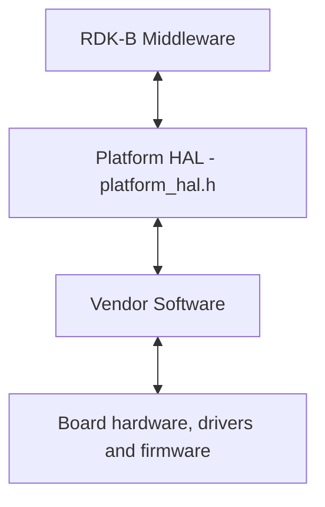
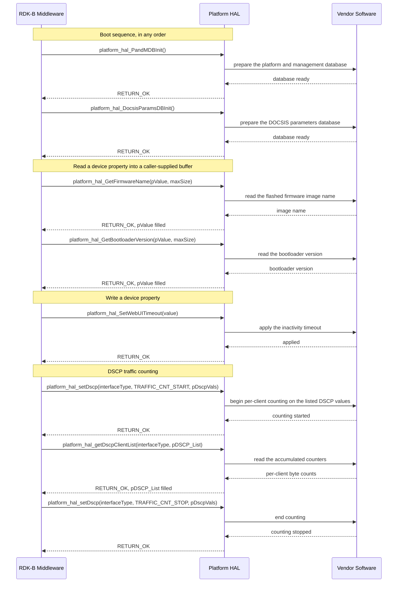

# PLATFORM HAL Documentation

## Version History

| Date | Comment | Version |
| --- | --- | --- |
| 2023-11-08 | Initial Platform HAL interface release under RDKB-52300. | 1.0.0 |
| 2023-11-13 | Repository housekeeping only; the declared interface did not change. | 1.0.1 |
| 2023-11-20 | DHCP option defines extended; header updated for the unified WAN manager under RDKB-52640. | 1.1.0 |
| 2023-12-28 | ECO mode status read added under RDKBDEV-2326. | 1.2.0 |
| 2024-11-25 | PPP username and password reads added under RDKBDEV-2733. | 1.2.1 |
| 2024-11-27 | QoS and traffic management added through `platform_hal_qos_apply`. | 1.3.0 |
| 2024-11-29 | Major version check aligned to `main` under issue #11; `build_ut.sh` updated. | 1.3.1 |
| 2024-11-29 | `platform_hal.h` corrected under issue #23. | 1.3.2 |
| Not stated in the repository changelog | Return value extended for unsupported HAL functions through `RETURN_UNSUPPORTED`, and the thermal manager functions implemented for XB10 and XB9, under RDKB-65287. | 1.3.3 |
| 2026-08-24 | Specification rewritten to the canonical RDK-B HAL topic set. Documentation only: the interface itself is unchanged, so this revision introduces no new release. | 1.3.3 (documentation revision) |

## Acronyms

- `HAL` \- Hardware Abstraction Layer
- `RDK-B` \- Reference Design Kit for Broadband Devices
- `OEM` \- Original Equipment Manufacturer
- `DOCSIS` \- Data Over Cable Service Interface Specification
- `DRAM` \- Dynamic Random Access Memory
- `DSCP` \- Differentiated Services Code Point
- `eMMC` \- embedded MultiMediaCard
- `ECO` \- Energy Conservation Operation, the device power-saving mode
- `LED` \- Light Emitting Diode
- `MACsec` \- Media Access Control Security
- `PandM` \- Platform and Management, the RDK-B provisioning and management database
- `PPP` \- Point-to-Point Protocol
- `PSM` \- Power Saving Mode
- `PWM` \- Pulse Width Modulation
- `QoS` \- Quality of Service
- `RPM` \- Revolutions Per Minute
- `SNMP` \- Simple Network Management Protocol
- `WAN` \- Wide Area Network

## Description



Platform HAL is the RDK-B abstraction over board and device details that belong to no single
subsystem. Through it, RDK-B Middleware reads hardware and firmware identity such as the model
name, serial number, base MAC address, hardware revision, software version, bootloader version and
firmware image name; reads flash and DRAM sizing; toggles remote management surfaces such as
Telnet, SSH, SNMP and the web user interface; drives LED, fan and thermal control; and applies QoS,
DSCP traffic counting and MACsec settings. The vendor supplies the implementation behind the
interface.

The RDK-B Middleware components that use this interface include `CcspPandMSsp`, `CcspDHCPMgr`,
`CcspEthAgent`, `CcspLMLite`, `RdkLedManager`, `RdkThermalManager`, `RdkXdslManager`,
`RdkPppManager`, `RdkVlanManager`, `onewifi` and `startse05xd`. The module stack below shows the
two classes of caller: RDK-B `Ccsp` components and RDK-B processes that are not `Ccsp`
components.


## Optional Components

Nine functions are declared only when a compile-time feature flag is defined; every other function
is always declared. Their availability is therefore decided by the build, not at run time.

- `FEATURE_RDKB_LED_MANAGER` gates `platform_hal_initLed()` and the `led_name` and `led_param`
  members of `LEDMGMT_PARAMS`, so the structure passed to `platform_hal_setLed()` differs in shape
  between the two builds.
- `FEATURE_RDKB_THERMAL_MANAGER` gates `platform_hal_initThermal()`,
  `platform_hal_LoadThermalConfig()`, `platform_hal_setFanSpeed()`,
  `platform_hal_getFanTemperature()`, `platform_hal_getInputCurrent()`,
  `platform_hal_getInputPower()`, `platform_hal_getRadioTemperature()` and
  `platform_hal_getEcoModeStatus()`, together with the types `FAN_SPEED`,
  `THERMAL_PLATFORM_CONFIG` and `FAN_ERR`.

The gating does not follow the function names. `platform_hal_setLed()` and `platform_hal_getLed()`
are always declared, as are `platform_hal_getFanSpeed()`, `platform_hal_getRPM()`,
`platform_hal_getRotorLock()`, `platform_hal_getFanStatus()` and `platform_hal_setFanMaxOverride()`.

## Component Runtime Execution Requirements

### Initialization and Startup

The initialization functions below let the vendor implementation open the databases it needs,
start any internal threads and prepare the hardware. RDK-B Middleware calls them during the boot
sequence, in any order.

- `platform_hal_PandMDBInit()`
- `platform_hal_DocsisParamsDBInit()`
- `platform_hal_initThermal()` \- declared only when `FEATURE_RDKB_THERMAL_MANAGER` is defined, so
  a build without that flag has a two-call initialization sequence

Third-party vendors implement these to meet their operational requirements.

`platform_hal_initLed()`, declared only when `FEATURE_RDKB_LED_MANAGER` is defined, initializes the
LED subsystem and reports the path of the vendor's LED configuration file. When it returns
`RETURN_ERR`, the caller treats the LED subsystem as unavailable and does not call the other LED
functions.

### Threading Model

The interface is not thread safe.

Any module invoking the interface must serialise each call against every other Platform HAL call
it makes.

Third-party vendors may create internal threads to meet their operational requirements. In that
case the vendor implementation is responsible for synchronizing between the calls and events and
for cleaning up the threads.

### Process Model

All functions in this interface are expected to be called from multiple processes. The interface
provides no cross-process locking, so a vendor implementation protects any shared platform
resource against concurrent entry from more than one process.

### Memory Model

A function that writes a string into a caller buffer either states a minimum buffer size on its
declaration or takes a `maxSize` argument giving the size of the buffer supplied, and
zero-terminates that string only where its declaration says so; a caller passes every string
argument zero-terminated.

#### Caller Responsibilities

- The caller allocates and releases every buffer and structure it passes to the interface, as each
  function's documentation specifies, and populates input structures fully.
- The caller supplies each output buffer at least as large as its documented minimum, and passes a
  `maxSize` no larger than the buffer it actually allocated.
- The caller bounds every read of a string output to the buffer size it supplied or the `maxSize`
  it reported. Where it needs a terminated string from an output not declared zero-terminated, it
  allocates one byte beyond the documented minimum, or reports a `maxSize` one byte short of its
  allocation, and zeroes that spare byte before the call.
- The caller keeps the storage it supplies valid during the call, and confirms with the vendor
  implementation that the pointer is no longer held before it reuses, overwrites or releases that
  storage.
- For `platform_hal_GetMemoryPaths()` the caller supplies only a pointer variable: the HAL allocates
  the `PLAT_PROC_MEM_INFO` array and returns its address. After a failed call the caller does not
  free that pointer; after a successful call it agrees with the implementer which side releases
  the array, and how, before relying on the result in a long-running process.
- Before reading or freeing anything reached through the lists that
  `platform_hal_GetDhcpv4_Options()` and `platform_hal_GetDhcpv6_Options()` return, the caller
  agrees with the implementer how a list ends, how long each value is and which side releases the
  nodes and their values.

#### Module Responsibilities

- Third-party vendors may allocate memory for their internal operational requirements and are
  responsible for de-allocating it internally.
- A module releases all internally allocated memory when it terminates, so that no resource leaks
  across a service restart.

### Power Management Requirements

The HAL is not involved in any power management operation. Any power management state transition
MUST not affect the operation of the HAL.

`platform_hal_SetLowPowerModeState()` sets a `PSM_STATE` value and `platform_hal_getEcoModeStatus()`
reports the ECO mode status of a radio module. Both handle power state as data-model values only
and do not make the HAL a participant in power management.

### Asynchronous Notification Model

There are no asynchronous notifications. The interface has no callback type or registration
function, so a caller that needs to observe a changing quantity, such as a temperature or an
interface counter, polls the function that reads it.

### Blocking calls

- Every function is synchronous: the calling thread is blocked until the operation completes.
- The initialization functions are expected to block while the hardware is not ready.
- An implementation applies a timeout to any call that can fail through lack of a response.
- `platform_hal_StartMACsec()` and `platform_hal_StopMACsec()` block by design until the start or
  stop operation on the port has an outcome, which may be failure. `platform_hal_StartMACsec()`
  returns once MACsec has started or the operation gives up; its `timeoutSec` argument is
  currently unused and is passed as 0, meaning retry forever. A caller does not invoke either
  function on a latency-sensitive path, checks the return value and, on `RETURN_ERR`, confirms the
  port's state with `platform_hal_GetMACsecOperationalStatus()` before retrying.

### Internal Error Handling

Status-reporting functions return their status synchronously, as the return value. The HAL handles
system errors, such as an out-of-memory condition, internally.

| Code | Value | Meaning | Caller action |
| --- | --- | --- | --- |
| `RETURN_OK` | 0 | The operation completed successfully. | Use the output. |
| `RETURN_ERR` | -1 | The operation failed; no more specific cause is reported. | Discard any output, then retry or report the failure. |
| `RETURN_UNSUPPORTED` | -2 | The platform does not implement the function. Returned only by `platform_hal_setFanSpeed`, `platform_hal_getFanTemperature`, `platform_hal_getInputCurrent`, `platform_hal_getInputPower`, `platform_hal_getRadioTemperature` and `platform_hal_getEcoModeStatus`. | Stop calling the function; the outcome is permanent for the platform. |

Four functions return a reading rather than a status code:

- `platform_hal_getRotorLock()` returns 1 for a locked rotor, 0 for an unlocked rotor and -1 where
  no rotor lock indication is available. The caller reads -1 as unknown, not as a failure, even
  though it equals `RETURN_ERR`.
- `platform_hal_getFanSpeed()`, `platform_hal_getRPM()` and `platform_hal_getFanStatus()` return the
  reading or state directly, so a return of 0 does not distinguish a stopped or disabled fan from a
  failed query.

### Persistence Model

There is no requirement for the HAL to persist any setting information. The caller is responsible
for persisting any settings related to its own implementation.

The values read through `platform_hal_getFactoryPartnerId()`, `platform_hal_getFactoryCmVariant()`
and `platform_hal_GetFactoryResetCount()` are held by the device rather than by the HAL, so a
caller reads them rather than persisting them. A caller that needs a rate from the counters of
`platform_hal_GetInterfaceStats()` differences two reads rather than relying on a starting value
or a persisted baseline.

## Non functional requirements

The following non functional requirements should be supported by the component.

### Logging and debugging requirements

The component is required to log all error and critical informative messages that help to debug
and triage issues and to understand the functional flow of the system. Logging uses the `syslog`
mechanism; `printf` is discouraged unless `syslog` is unavailable. Logging is consistent across all
HAL components.

Log levels follow the Linux standard logging system, in descending order of severity: `FATAL`, `ERROR`, `WARNING`, `NOTICE`, `INFO`, `DEBUG` and `TRACE`. Each log entry carries a timestamp, the log level and a message describing the event or condition.

Because `RETURN_ERR` carries no cause, the implementation logs the cause of every failure it
detects, including failed fan readings.

Implementations must not log credentials, secrets, security-sensitive information, or other sensitive data.

### Memory and performance requirements

The component should not contribute disproportionately to memory or CPU utilization while
performing normal operations, and its consumption should be commensurate with the operation
requested.

The largest single allocation this interface requires is the caller-allocated `DSCP_list_t`,
which holds up to 64 `DSCP_Element_t` entries of up to 256 `Traffic_client_t` entries each.

### Quality Control

An implementation should pass analysis with third-party tools such as `Coverity`, `Black Duck` and `Valgrind` without reported issues. Neither the HAL implementation nor the vendor software beneath it may introduce memory leaks or memory corruption.

Any change to a file listed under `Source References` obliges a review of this document by the repository maintainers, through the issue and pull-request process `CONTRIBUTING.md` describes.

### Licensing

The interface definition is licensed under the Apache License 2.0, with the full text in `LICENSE` and the attribution notice in `NOTICE`. An implementation of this interface is expected to be released under the Apache License 2.0.

### Build Requirements

The source code should be built under the Linux Yocto environment and delivered as a shared
library named `libhal_platform.so`.

To use the Platform HAL capabilities from a component or process:

1. Include `platform_hal.h`, which carries all function prototypes and datatype definitions for
   this interface.
2. Add a linker dependency on `libhal_platform.so`.

The documentation build, `docs/generate_docs.sh`, predefines `FEATURE_RDKB_THERMAL_MANAGER` and
`FEATURE_RDKB_LED_MANAGER`, so the generated reference covers all 71 functions and the gated types
and members. This affects only the generated documentation: which declarations a product build
sees is decided by the flags that build defines.

### Variability Management

Changes to the interface are controlled by versioning. Vendors implement a designated version of the interface and move to later versions as their service agreements require. Each interface version follows [Semantic Versioning 2.0.0](https://semver.org/spec/v2.0.0.html), and vendor code complies with a specific version. The interface version is identified by the repository's release tag; this document describes release `1.3.3`.

The two compile-time flags under `Optional Components` are the declared variability of this
interface. Within the thermal block, `RETURN_UNSUPPORTED` reports at run time that a platform
compiles a function in but does not implement it.

### Platform or Product Customization

The product can be configured through the following compile-time defines:

```c
FEATURE_RDKB_LED_MANAGER
FEATURE_RDKB_THERMAL_MANAGER
```

Beyond these flags, product variation is carried in the values the interface reports: the model
name, router region, hardware version, factory partner identifier and factory cable-modem variant
are read through it, and the LED colour set, fan count and thermal thresholds are vendor or OEM
specific.

The thermal and LED functions are intended upstream to move into HALs of their own. In this
release both families are declared in `platform_hal.h` and are part of this interface.

## Interface API Documentation

All function prototypes and datatype definitions for this interface are declared in
`platform_hal.h`. The Doxygen comment on each declaration carries the per-function reference:
argument ranges, buffer ownership and minimum sizes, pre-conditions, post-conditions, return values
and their meaning, blocking behaviour and thread safety.

### Theory of operation and key concepts

Platform HAL is a flat function interface with no handle, session or object a caller creates or
destroys. A caller includes the header, links the library, performs the boot-time initialization
calls, and then calls individual functions that each read or set one platform property. The
exceptions are the DSCP traffic-counting group, which accumulates counters between a start and a
stop, and the MACsec group, which starts and stops a protocol on a port.

Sixty-seven of the seventy-one functions return a status code and deliver their result through an
output argument; the four fan readings named under `Internal Error Handling` return the value
itself.

#### Object Lifecycles

- **Creation:** The interface creates nothing on the caller's behalf and returns no handle. The
  boot-time initialization functions prepare vendor-internal state.
- **Usage:** The interface reads or fills `LEDMGMT_PARAMS`, `THERMAL_PLATFORM_CONFIG`,
  `FW_BANK_INFO`, `INTF_STATS`, `DSCP_list_t` and `hal_network_params_t`; their allocation and
  release are set out under `Memory Model`.
- **Destruction:** There is no teardown, deinitialization or close function, so the vendor-internal
  state established at initialization persists for the lifetime of the process.
- **Identifiers:** Hardware is addressed by small integer index: a fan index, an Ethernet port
  number, a radio index, an LED index bounded by `LED_BUFFER_SIZE`, a processor selected by
  `RDK_CPUS`, a firmware bank selected by `FW_BANK` and a WAN interface selected by
  `WAN_INTERFACE`.

#### Method Sequencing

- **Initialization first:** The calls listed under `Initialization and Startup` precede all
  others, and a caller performs the full initialization sequence for its build.
- **Paired sequences:** `platform_hal_setDscp` with `TRAFFIC_CNT_START` begins traffic counting,
  `platform_hal_getDscpClientList` reads the accumulated counters, `platform_hal_resetDscpCounts`
  clears them and `platform_hal_setDscp` with `TRAFFIC_CNT_STOP` ends counting.
  `platform_hal_StartMACsec` and `platform_hal_StopMACsec` bracket MACsec operation on a port.
  `platform_hal_LoadThermalConfig` supplies the default thresholds a caller may then apply.
- **Other calls:** Everything else is order-independent once initialization has completed,
  subject to the serialisation the `Threading Model` requires.

#### State-Dependent Behavior

- **Configuration progress:** A caller reads `platform_hal_GetDeviceConfigStatus()` to decide
  whether configuration-dependent work may proceed.
- **Administrative against operational state:** `platform_hal_GetMACsecEnable` reports the
  administrative setting and `platform_hal_GetMACsecOperationalStatus` reports whether MACsec is
  actually configured at the interface or driver level. The two can legitimately disagree, and a
  caller that needs the state of the link reads the operational one.
- **Readings change with hardware state:** The fan, temperature, current, power and interface
  statistics functions return values that depend on the platform's condition at the time of the
  call.
- **Build state changes the surface:** Nine functions are absent when their feature flag is
  undefined (see `Optional Components`), and six thermal functions may return
  `RETURN_UNSUPPORTED` even when declared (see `Internal Error Handling`).

### Data Structures and Defines

The types below appear in the signatures of this interface, so a caller constructs or interprets
them. All are declared in `platform_hal.h`, which documents the meaning and valid range of every
member.

**Status codes:** `RETURN_OK`, `RETURN_ERR` and `RETURN_UNSUPPORTED`; their values and the caller
action for each are set out under `Internal Error Handling`.

**Primitive type aliases:** `CHAR` for `char`, `UCHAR` for `unsigned char`, `BOOLEAN` for
`unsigned char` carrying `TRUE` or `FALSE`, `INT` for `int`, `UINT` for `unsigned int`, `ULONG` for
`unsigned long`, and the fixed-width aliases `UINT8_t`, `UINT16_t`, `UINT32_t` and `UINT64_t`.
`ENABLE`, value 1, denotes an enabled state.

**Buffer and capacity limits:** `FW_NAME_MAX_LEN` 64 and `FW_STATE_MAX_LEN` 64 size the firmware
bank strings; `PLAT_PROC_MEM_MAX_LEN` 40 sizes each memory path string; `LED_BUFFER_SIZE` 3 is the
number of LED entries a caller may address.

**DHCP option codes:** `DHCPV6_OPT_3` onwards and the DHCPv4 set ending at `DHCPV4_OPT_END`, value
255, are the codes carried in the `dhcp_opt` member of `dhcp_opt_list`. `DHCPV4_OPT_END` is the
sentinel used to check whether an option is valid.

**Enumerations and structures:**

| Type | What it represents |
| --- | --- |
| `RDK_CPUS` | Processor selector: `HOST_CPU`, `PEER_CPU`, `NOT_SUPPORTED_CPU`. Argument to `platform_hal_GetMemoryPaths`. |
| `PLAT_PROC_MEM_INFO` | DRAM and three eMMC storage paths for one processor, each bounded by `PLAT_PROC_MEM_MAX_LEN`. |
| `LED_COLOR` | LED colour selector, from `LED_WHITE` through the combined colours to `NOT_SUPPORTED`. |
| `LEDMGMT_PARAMS` | LED configuration: colour, state \- solid or blink \- and blink interval in seconds. |
| `FAN_SPEED` | Discrete fan speed setting; values under `State Diagram`. |
| `THERMAL_PLATFORM_CONFIG` | Platform fan configuration: fan count, the three temperature thresholds, minimum run time, monitoring delay, power monitoring and log interval. |
| `FAN_ERR` | Fan operation error state; values under `State Diagram`. |
| `dhcp_opt_list` | Singly linked list node carrying one DHCPv4 or DHCPv6 option code and its value. |
| `PSM_STATE` | Power saving mode state, as data-model state only; values under `State Diagram`. |
| `WAN_INTERFACE` | WAN interface selector for DSCP traffic counting: `DOCSIS`, `EWAN`. |
| `TRAFFIC_CNT_COMMAND` | Start or stop selector for DSCP traffic counting: `TRAFFIC_CNT_START`, `TRAFFIC_CNT_STOP`. |
| `Traffic_client_t` | Byte counters for one client against a single DSCP value, with the client MAC address. |
| `DSCP_Element_t` | One DSCP value with its client count and a fixed array of up to 256 client entries; only the first `numClients` are meaningful. |
| `DSCP_list_t` | Complete DSCP counting result for one WAN interface: up to 64 elements, of which only the first `numElements` are meaningful. |
| `FW_BANK` | Firmware bank selector: `ACTIVE_BANK`, `INACTIVE_BANK`. |
| `FW_BANK_INFO` | Firmware image name and trial-boot state for one bank, as text in `fw_name` and `fw_state`, bounded by `FW_NAME_MAX_LEN` and `FW_STATE_MAX_LEN` respectively; a caller bounds each read to its field's size and does not rely on a terminator. |
| `INTF_STATS` | Packet and byte counters for one network interface, covering LAN-to-WAN and WAN-to-LAN traffic only. |
| `ip_version_t` | IP version selector for QoS parameters: `IP_VERSION_IPV4`, `IP_VERSION_IPV6`. |
| `net_proto_t` | Transport protocol selector for QoS parameters: `PROTOCOL_TCP`, `PROTOCOL_UDP`. |
| `hal_network_params_t` | The QoS and traffic management parameter set: source and destination MAC and IP addresses, ports, protocol and DSCP value. |

Each of these types also carries a pointer alias where the interface uses one, for example
`PLEDMGMT_PARAMS`, `PPLAT_PROC_MEM_INFO`, `PPSM_STATE`, `PFW_BANK_INFO`, `PINTF_STATS`,
`pDSCP_list_t`, `pDSCP_Element_t` and `pTraffic_client_t`.

### API Surface

The complete declared surface of this interface is the seventy-one functions below, grouped by
functional area. Sixty-seven return `INT`, two return `UINT`, one returns `BOOLEAN` and one returns
`int`. Functions marked *flag* are declared only when their feature flag is defined, as set out
under `Optional Components`.

**Boot-time initialization:**

| Function | Purpose |
| --- | --- |
| `platform_hal_PandMDBInit()` | Initialises the Platform and Management database. |
| `platform_hal_DocsisParamsDBInit()` | Initialises the DOCSIS parameters database. |

**Device configuration status and remote management:**

| Function | Purpose |
| --- | --- |
| `platform_hal_GetDeviceConfigStatus()` | Reports how far the device has progressed through its configuration sequence. |
| `platform_hal_GetTelnetEnable()` | Reports whether Telnet access is currently enabled. |
| `platform_hal_SetTelnetEnable()` | Enables or disables Telnet access. |
| `platform_hal_GetSSHEnable()` | Reports whether SSH access is currently enabled. |
| `platform_hal_SetSSHEnable()` | Enables or disables SSH access. |
| `platform_hal_GetSNMPEnable()` | Reports which interface scope SNMP is currently enabled for. |
| `platform_hal_SetSNMPEnable()` | Selects the interface scope SNMP is enabled for. |
| `platform_hal_SetSNMPOnboardRebootEnable()` | Allows or suppresses SNMP-initiated reboots during onboarding. |
| `platform_hal_GetWebUITimeout()` | Reports the configured web user-interface inactivity timeout. |
| `platform_hal_SetWebUITimeout()` | Sets the web user-interface inactivity timeout. |
| `platform_hal_GetWebAccessLevel()` | Reads the web access level granted to a user on an interface. |
| `platform_hal_SetWebAccessLevel()` | Sets the web access level granted to a user on an interface. |

**Device and firmware identity:**

| Function | Purpose |
| --- | --- |
| `platform_hal_GetModelName()` | Reads the device model name. |
| `platform_hal_GetRouterRegion()` | Reads the regulatory region the router is provisioned for. |
| `platform_hal_GetSerialNumber()` | Reads the device serial number. |
| `platform_hal_GetHardwareVersion()` | Reads the hardware revision of the device. |
| `platform_hal_GetSoftwareVersion()` | Reads the software version currently flashed on the device. |
| `platform_hal_GetBootloaderVersion()` | Reads the bootloader version currently flashed on the device. |
| `platform_hal_GetFirmwareName()` | Reads the name of the firmware image flashed on the device. |
| `platform_hal_GetBaseMacAddress()` | Reads the base MAC address of the device. |
| `platform_hal_GetFirmwareBankInfo()` | Reads the firmware image name and state held in a given bank. |

**Flash and memory inventory:**

| Function | Purpose |
| --- | --- |
| `platform_hal_GetHardware()` | Reads the total flash size of the device in megabytes. |
| `platform_hal_GetHardware_MemUsed()` | Reads the used flash size of the device in megabytes. |
| `platform_hal_GetHardware_MemFree()` | Reads the available flash size of the device in megabytes. |
| `platform_hal_GetTotalMemorySize()` | Reads the total DRAM size of the device in megabytes. |
| `platform_hal_GetUsedMemorySize()` | Reads the DRAM currently in use, in megabytes. |
| `platform_hal_GetFreeMemorySize()` | Reads the DRAM currently free, in megabytes. |
| `platform_hal_GetMemoryPaths()` | Reads the DRAM and eMMC storage paths of a given processor. |
| `platform_hal_GetCPUSpeed()` | Reads the processor speed in bogomips. |

**Factory state, reset and image validity:**

| Function | Purpose |
| --- | --- |
| `platform_hal_GetFactoryResetCount()` | Reads how many times the device has been factory reset. |
| `platform_hal_ClearResetCount()` | Clears the factory reset counter. |
| `platform_hal_getTimeOffSet()` | Reads the device's time offset from UTC. |
| `platform_hal_SetDeviceCodeImageTimeout()` | Sets the hardware watchdog timeout. |
| `platform_hal_SetDeviceCodeImageValid()` | Marks the flashed firmware image valid or invalid. |
| `platform_hal_getFactoryPartnerId()` | Reads the factory-programmed partner identifier. |
| `platform_hal_getFactoryCmVariant()` | Reads the factory-programmed cable-modem variant. |
| `platform_hal_setFactoryCmVariant()` | Sets the factory-programmed cable-modem variant. |

**LED control:**

| Function | Purpose |
| --- | --- |
| `platform_hal_initLed()` | *flag* Initialises the LED layer and reports the path of its configuration file. |
| `platform_hal_setLed()` | Applies an LED configuration to the device. |
| `platform_hal_getLed()` | Reads the LED configuration in force at the time of the call. |

**Fan control and readings:**

| Function | Purpose |
| --- | --- |
| `platform_hal_getFanSpeed()` | Reads the PWM-derived speed of a fan. |
| `platform_hal_getRPM()` | Reads the rotation rate of a fan. |
| `platform_hal_getRotorLock()` | Reads the rotor lock status of a fan. |
| `platform_hal_getFanStatus()` | Reads whether a fan is enabled. |
| `platform_hal_setFanMaxOverride()` | Forces a fan to maximum speed, or releases it back to normal control. |
| `platform_hal_setFanSpeed()` | *flag* Sets a fan to one of the platform's discrete speed settings. |

**Thermal, power and ECO mode:**

| Function | Purpose |
| --- | --- |
| `platform_hal_initThermal()` | *flag* Initialises the thermal layer and reports the platform's fan configuration. |
| `platform_hal_LoadThermalConfig()` | *flag* Loads the default thermal thresholds into a configuration structure. |
| `platform_hal_getFanTemperature()` | *flag* Reads the current device temperature. |
| `platform_hal_getInputCurrent()` | *flag* Reads the platform's input current. |
| `platform_hal_getInputPower()` | *flag* Reads the platform's input power. |
| `platform_hal_getRadioTemperature()` | *flag* Reads the temperature of one radio module. |
| `platform_hal_getEcoModeStatus()` | *flag* Reads the ECO mode status of one radio module. |
| `platform_hal_SetLowPowerModeState()` | Sets the platform's power-saving mode state. |

**MACsec:**

| Function | Purpose |
| --- | --- |
| `platform_hal_GetMACsecEnable()` | Reads whether MACsec is enabled on a port, administratively. |
| `platform_hal_SetMACsecEnable()` | Enables or disables MACsec on a port. |
| `platform_hal_GetMACsecOperationalStatus()` | Reads whether MACsec is actually configured at the interface or driver level. |
| `platform_hal_StartMACsec()` | Starts MACsec on a port and waits for the outcome. |
| `platform_hal_StopMACsec()` | Stops MACsec on a port and waits for the outcome. |

**WAN, DHCP options and PPP credentials:**

| Function | Purpose |
| --- | --- |
| `platform_hal_GetDhcpv4_Options()` | Reads the DHCPv4 options the platform requests and sends. |
| `platform_hal_GetDhcpv6_Options()` | Reads the DHCPv6 options the platform requests and sends. |
| `platform_hal_getCMTSMac()` | Reads the MAC address of the CMTS the device is attached to. |
| `platform_hal_GetInterfaceStats()` | Reads packet and byte counters for a named network interface. |
| `platform_hal_GetPppUserName()` | Reads the PPP username configured for the WAN connection. |
| `platform_hal_GetPppPassword()` | Reads the PPP password configured for the WAN connection. |

**DSCP traffic counting and QoS:**

| Function | Purpose |
| --- | --- |
| `platform_hal_setDscp()` | Starts or stops per-client traffic counting for a set of DSCP values. |
| `platform_hal_resetDscpCounts()` | Resets the DSCP traffic counters for a WAN interface. |
| `platform_hal_getDscpClientList()` | Reads the accumulated DSCP traffic counters for a WAN interface. |
| `platform_hal_qos_apply()` | Applies QoS and traffic management settings from a network parameter set. |

### Sequence Diagram

The exchange below shows the boot-time initialization, a read, a write and the DSCP
traffic-counting sequence between RDK-B Middleware, Platform HAL and Vendor Software.



The diagrams in this document are fenced `mermaid` blocks. They render on GitHub, where the
repository `README.md` presents this page; the generated Doxygen site shows their source text.

### State Diagram

The interface exposes the status values below but does not define the transitions between them,
so no state diagram is drawn. A caller observes these values by polling.

- **Device configuration progress:** `platform_hal_GetDeviceConfigStatus` reports
  `WaitForImplement`, `In Progress` or `Complete`.
- **Power saving mode:** `PSM_STATE` carries `PSM_UNKNOWN`, `PSM_AC`, `PSM_BATT`, `PSM_HOT`,
  `PSM_COOLED` or `PSM_NOT_SUPPORTED`.
- **Fan state:** `platform_hal_getFanStatus` reports enabled or disabled and
  `platform_hal_getRotorLock` the rotor lock status; `FAN_SPEED` enumerates `FAN_SPEED_OFF`,
  `FAN_SPEED_SLOW`, `FAN_SPEED_MEDIUM`, `FAN_SPEED_FAST` and `FAN_SPEED_MAX`; `FAN_ERR` enumerates
  `FAN_ERR_NONE`, `FAN_ERR_HW` and `FAN_ERR_MAX_OVERRIDE_SET`.
- **MACsec state:** `platform_hal_GetMACsecEnable` (administrative) and
  `platform_hal_GetMACsecOperationalStatus` (operational).
- **Firmware bank state:** the `fw_state` member of `FW_BANK_INFO` holds `confirmed` or
  `TrialBoot#0` through `TrialBoot#n`, where the upper bound is vendor specific.
- **ECO mode:** `platform_hal_getEcoModeStatus`, per radio module.

## Source References

- [rdkcentral/rdkb-halif-platform/include/platform_hal.h](https://github.com/rdkcentral/rdkb-halif-platform/blob/develop/include/platform_hal.h) — interface declarations, types and the per-function Doxygen reference
- [rdkcentral/rdkb-halif-platform/docs/pages/images/Platform_HAL_Architecture.png](https://github.com/rdkcentral/rdkb-halif-platform/blob/develop/docs/pages/images/Platform_HAL_Architecture.png) — module-stack architecture diagram shown under `Description`
- [rdkcentral/rdkb-halif-platform/CHANGELOG.md](https://github.com/rdkcentral/rdkb-halif-platform/blob/develop/CHANGELOG.md) — release history behind `Version History`
- [rdkcentral/rdkb-halif-platform/docs/generate_docs.sh](https://github.com/rdkcentral/rdkb-halif-platform/blob/develop/docs/generate_docs.sh) — documentation build and its feature-flag predefines
- [rdkcentral/rdkb-halif-platform/CONTRIBUTING.md](https://github.com/rdkcentral/rdkb-halif-platform/blob/develop/CONTRIBUTING.md) — contribution and review flow
- [rdkcentral/rdkb-halif-platform/LICENSE](https://github.com/rdkcentral/rdkb-halif-platform/blob/develop/LICENSE) — Apache License 2.0 text
- [rdkcentral/rdkb-halif-platform/NOTICE](https://github.com/rdkcentral/rdkb-halif-platform/blob/develop/NOTICE) — attribution notice
